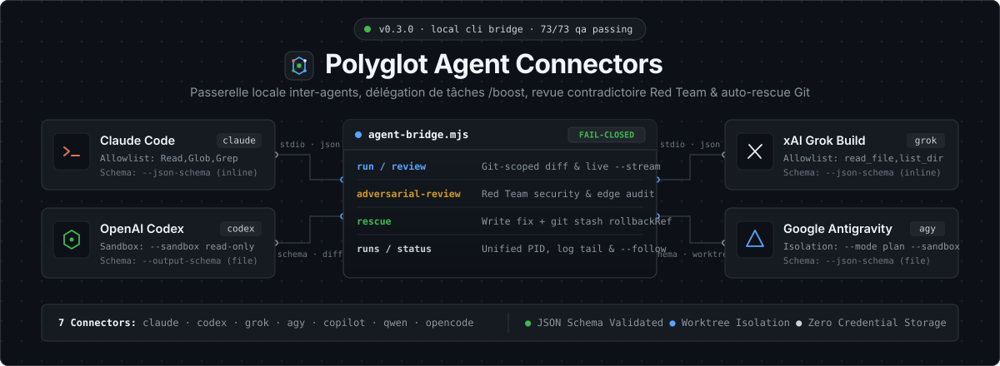
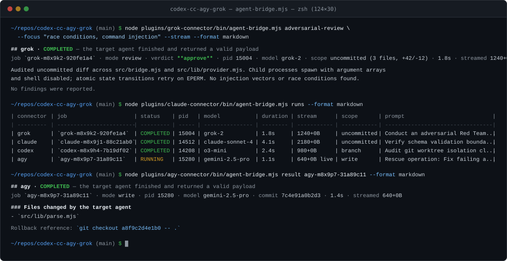

# Bridge codex - grok - claude - antigravity




<br/>

# ⚡ Polyglot Agent Connectors (`codex-cc-agy-grok`)

### **La Passerelle Multi-Agents Ultime & Solutions `/boost`**
### *The Ultimate Cross-Agent Bridge for Claude Code, OpenAI Codex, xAI Grok & Google Antigravity*

[](package.json)
[](tests/)
[](#📊-cross-agent-provider-comparison-matrix)
[](docs/boost-solutions.md)
[](docs/cross-agent-bridge.md)
[](package.json)
[](LICENSE)

<p align="center">
  <b>Interconnectez vos agents de codage IA préférés dans un maillage autonome, symétrique et sécurisé.</b><br/>
  <b>Déléguez des tâches entre Claude Code, Codex, Grok et Antigravity • Revues Red Team • Rescue sur branche Git isolée.</b>
</p>

[Présentation en Français](#-passerelle-multi-agents--solutions-boost-en-français) •
[⚡ Solutions /boost](#-solutions-boost--high-velocity-workflows) •
[🖥️ Aperçu Terminal](#️-aperçu-terminal--cli-execution--live-runs) •
[🏛️ Architecture](#-visual-architecture--cross-agent-mesh) •
[📊 Comparatif 7 Agents](#-cross-agent-provider-comparison-matrix) •
[🚀 Installation](#-quickstart--installation) •
[📚 Docs & SEO](#-documentation-guides--ai-indexing)

---

</div>

> **Pourquoi choisir entre Claude Code, Codex, Grok et Antigravity quand vous pouvez déléguer à chacun ce qu'il fait de mieux ?**  
> **Polyglot Agent Connectors** fournit la passerelle locale permettant à **Claude Code**, **OpenAI Codex**, **xAI Grok Build**, **Google Antigravity**, **GitHub Copilot**, **Qwen Code** et **OpenCode** de collaborer en pair-à-pair : déléguez des sous-tâches ciblées (`/boost`), lancez des audits de sécurité contradictoires (`adversarial-review`), faites corriger vos tests cassés sur une branche Git isolée (`rescue`) et suivez vos jobs (`runs`, `wait`).

---

## 🖥️ Aperçu Terminal — CLI Execution & Live Runs

<div align="center">
  
</div>

---

## 🇫🇷 Passerelle Multi-Agents & Solutions `/boost` (En Français)

### Comment fonctionne la passerelle entre Claude Code, Codex, Grok et Antigravity ?

Chaque agent IA possède des forces uniques. Plutôt que de copier-coller manuellement du code d'un terminal à l'autre, **Polyglot Agent Connectors** installe **un seul plugin, `polyglot`** : un pont unifié (`plugins/polyglot/bin/agent-bridge.mjs`), 11 commandes slash (`/polyglot:review`, `/polyglot:adversarial-review`, `/polyglot:rescue`, `/polyglot:delegate`, `/polyglot:handoff`, `/polyglot:wait`, `/polyglot:runs`, `/polyglot:status`, `/polyglot:result`, `/polyglot:cancel`, `/polyglot:setup`), un skill `delegate` et un agent `delegate` dans chaque environnement hôte. Chaque commande de job prend `--to codex|claude|grok|agy|copilot|qwen|opencode`.

Flux recommandé : lancer le job avec `--background`, puis bloquer sur `wait <job-id>`. Pour solliciter plusieurs agents, lancez un job en arrière-plan par provider, puis `wait id1 id2`.

| Pilier `/boost` | Commande Clé | Objectif & Valeur Ajoutée | Garantie de Sécurité |
| :--- | :--- | :--- | :--- |
| **1. Délégation Multi-Agents** | `run --to <provider> --prompt "<tâche>"` | Déléguer chaque tâche à l'agent optimal : architecture à **Claude Code**, algorithmique complexe à **Codex**, audit rapide à **Grok**, planification à **Antigravity**. | Lecture seule (`review`) par défaut ; sandbox OS, liste blanche d'outils ou mode plan selon l'agent. |
| **2. Revue Red Team Contradictoire** | `adversarial-review --to <provider> --focus "<cible>"` | Briser le biais de confirmation en faisant auditer le code d'un agent par un agent concurrent spécialisé en sécurité et cas limites. | Verdict structuré et validé par JSON Schema (`approve`, `needs-attention`, `could-not-review`). |
| **3. Auto-Sauvetage Résilient** | `rescue --to <provider> --error "<log>" --test "<cmd>" --confirm-write` | Faire corriger un build ou des tests unitaires cassés par l'agent cible, en mode écriture (`write`). | Travail dans un worktree Git sur la branche `polyglot/<job-id>` : votre arbre de travail n'est jamais modifié. Vous inspectez, appliquez ou supprimez la branche. |
| **4. Supervision Temps Réel** | `runs`, `wait <id>` & `status <id> --follow` | Suivre les jobs en arrière-plan dans un tableau de bord unifié (PIDs, durée live, modèle, coût, flux `stdout`/`stderr`) et attendre leurs résultats. | Journal d'événements `events.ndjson` et marquage `STALE` des jobs dont le worker a disparu. |

---

## 🏛️ Visual Architecture & Cross-Agent Mesh

```text
                     ┌────────────────────────────────────────────────────────┐
                     │                  AUTONOMOUS AGENT HOSTS                │
                     │  Claude Code  •  OpenAI Codex  •  Grok Build  •  Agy   │
                     └───────────────────────────┬────────────────────────────┘
                                                 │  (Slash Commands / Skill / CLI)
                                                 ▼
┌─────────────────────────────────────────────────────────────────────────────────────────────┐
│                UNIFIED AGENT BRIDGE (plugins/polyglot/bin/agent-bridge.mjs)                 │
│                                                                                             │
│  • /boost Delegation Engine              • Red Team Adversarial Review                      │
│  • Git Scope Resolution (Diffs)          • Rescue Engine (polyglot/<job-id> branch)         │
│  • Cycle Guard (Max Depth 3)             • Job Dashboard (runs / wait / status)             │
│  • Worktree & OS Sandboxing              • Zero-Credential Leak Safety Model                │
│  • One config per provider (bin/providers/<id>.json)                                        │
└──────┬───────────────────────┬───────────────────────┬───────────────────────┬──────────────┘
       │                       │                       │                       │
       ▼                       ▼                       ▼                       ▼
┌───────────────┐       ┌───────────────┐       ┌───────────────┐       ┌───────────────┐
│  Claude Code  │       │ OpenAI Codex  │       │  Grok Build   │       │  Antigravity  │
│  `claude` CLI │       │  `codex` CLI  │       │  `grok` CLI   │       │   `agy` CLI   │
│ Tool Filter & │       │ Native OS     │       │ Tool Filter & │       │ Plan Mode &   │
│ Inline Schema │       │ Sandboxing    │       │ Prompt File   │       │ Scoped Dirs   │
└───────────────┘       └───────────────┘       └───────────────┘       └───────────────┘
       │                       │                       │
       ▼                       ▼                       ▼
┌───────────────┐       ┌───────────────┐       ┌───────────────┐
│GitHub Copilot │       │   Qwen Code   │       │   OpenCode    │
│ `copilot` CLI │       │  `qwen` CLI   │       │`opencode` CLI │
└───────────────┘       └───────────────┘       └───────────────┘
```

---

## ⚡ Solutions `/boost` : High-Velocity Workflows (English)

The **`/boost` solutions** remove single-model bottlenecks by letting you delegate work to the right agent directly from your terminal or IDE:

- **🚀 Delegation Booster (`run`)**: Route specialized tasks to the best model without leaving your current session. Launch with `--background` and block on `wait`; use `--stream` for real-time output streaming and `--verbose` for timestamped provider telemetry on stderr. To ask several agents, launch one background job per provider, then `wait id1 id2`.
- **🛡️ Adversarial Red Team Audit (`adversarial-review`)**: Challenge your uncommitted or branch changes against a hostile Red Team prompt focused on injection vectors, race conditions, memory leaks, and auth bypasses.
- **🚑 Autonomous Crash Rescue (`rescue`)**: Pass a stack trace (`--error`) and test command (`--test`) with `--confirm-write`. The target agent diagnoses and fixes the bug in a git worktree on a `polyglot/<job-id>` branch. Your working tree is never written by the bridge (a job is flagged `sourceTreeModified` if the agent wrote there anyway): you inspect, apply or discard the branch.
- **📊 Live Supervision Dashboard (`runs`, `wait`, `status --follow`)**: Monitor background jobs across all 7 providers in one dashboard with live elapsed time, host PIDs, cost, byte heartbeats, and log tailing.
- **🔄 Cross-Host Context Handoff (`handoff`)**: Transfer a derived conversation digest (not a lossless session resume) from Claude Code, Codex, Grok, or Antigravity to any peer agent.

---

## 📊 Cross-Agent Provider Comparison Matrix

All **7 providers** are driven by **one plugin** (`plugins/polyglot`) and **one bridge**. Each provider is a declarative config in `plugins/polyglot/bin/providers/<id>.json`, checked by `npm run validate`. There is no build step: the plugin source is the plugin.

| Provider | Config | CLI Binary | Read-Only Enforcement | Structured Output | Prompt Delivery | Live Streaming |
| :--- | :--- | :--- | :--- | :--- | :--- | :--- |
| **OpenAI Codex** | [`codex.json`](plugins/polyglot/bin/providers/codex.json) | `codex` | Native OS Sandbox (`--sandbox read-only`) | File Schema (`--output-schema`) | stdin (`exec -`) | ✅ `--stream` |
| **Claude Code** | [`claude.json`](plugins/polyglot/bin/providers/claude.json) | `claude` | Tool Allowlist (`Read,Glob,Grep`) | Inline Schema (`--json-schema`) | stdin (`-p`) | ✅ `--stream` |
| **xAI Grok Build** | [`grok.json`](plugins/polyglot/bin/providers/grok.json) | `grok` | Tool Allowlist (`read_file,list_dir,grep`) | Inline Schema (`--json-schema`) | `--prompt-file` | ✅ `--stream` |
| **Google Antigravity** | [`agy.json`](plugins/polyglot/bin/providers/agy.json) | `agy` | Plan Mode (`--mode plan --sandbox`) | File Schema (`--json-schema`) | stdin (one `stream-json` message) | ✅ `--stream` |
| **GitHub Copilot** | [`copilot.json`](plugins/polyglot/bin/providers/copilot.json) | `copilot` (standalone CLI, not `gh copilot`) | Deny Tools (`--deny-tool=write --deny-tool=shell`) | Schema in prompt, payload validated by the bridge | stdin | ✅ `--stream` |
| **Qwen Code** | [`qwen.json`](plugins/polyglot/bin/providers/qwen.json) | `qwen` | Plan Approval Mode (`--approval-mode plan`) | Inline Schema (`--json-schema`) | stdin | ✅ `--stream` |
| **OpenCode** | [`opencode.json`](plugins/polyglot/bin/providers/opencode.json) | `opencode run` | Permission env (`OPENCODE_PERMISSION` denies edit and bash) | Schema in prompt, payload validated by the bridge | stdin | ✅ `--stream` |

Writes work the same way for every provider: `--mode write --confirm-write` runs the agent in a git worktree on a `polyglot/<job-id>` branch (see the safety model below). The diff-embedding prompt goes on stdin or in a prompt file, never as a command-line argument, which avoids `spawn ENAMETOOLONG` on Windows with large diffs.

> **Not yet verified**: the success output shapes of the Grok and Copilot CLIs (they were not logged in during verification), and Antigravity's plan-mode read-only enforcement.

---

## 🚀 Quickstart & Installation

### 1. Preview or Apply Installation Across All Hosts
The installer runs in **dry-run mode by default** and prints every command before modifying your environment:

```powershell
# Preview installation commands for all hosts
node scripts/install.mjs --host all

# Apply installation across all hosts (Codex, Claude Code, Grok Build, Antigravity, Qwen Code, OpenCode, Copilot)
node scripts/install.mjs --host all --apply
```

Install for a single specific host (`claude|codex|grok|agy|qwen|opencode|copilot`):
```powershell
node scripts/install.mjs --host claude --apply
node scripts/install.mjs --host codex --apply
node scripts/install.mjs --host grok --apply
node scripts/install.mjs --host agy --apply
```
On Claude Code, the installer first uninstalls the old `*-connector` plugins, then installs `polyglot`.

### 2. Verify CLI Readiness & Flag Compatibility
```powershell
# Check CLI installation and authentication status
node plugins/polyglot/bin/agent-bridge.mjs setup --format markdown

# Run deep diagnostic: flag audit, stale job reaping, and isolation garbage collection
node plugins/polyglot/bin/agent-bridge.mjs doctor
```

---

## 💻 Complete CLI Commands Cheat Sheet

Every job command takes `--to codex|claude|grok|agy|copilot|qwen|opencode`. Launch with `--background`, then `wait`.

### ⚡ 1. Instant Task Delegation (`/boost`)
```powershell
# Delegate a read-only analysis task, then block until it finishes
node plugins/polyglot/bin/agent-bridge.mjs run --to codex --prompt "Analyze algorithmic complexity" --effort high --background
node plugins/polyglot/bin/agent-bridge.mjs wait <job-id> --format markdown

# Delegate a refactoring task in write mode (requires explicit --confirm-write; lands on a polyglot/<job-id> branch)
node plugins/polyglot/bin/agent-bridge.mjs run --to claude --prompt "Modularize parser" --mode write --confirm-write --background

# Run a long task in an isolated detached Git worktree in the background
node plugins/polyglot/bin/agent-bridge.mjs run --to grok --prompt "Audit all dependencies" --isolate --background

# Ask several agents: one background job per provider, then wait on every id
node plugins/polyglot/bin/agent-bridge.mjs wait <job-id-1> <job-id-2> --timeout 9m --format markdown
```

### 🛡️ 2. Git-Scoped Code Review & Adversarial Red Team Audit
```powershell
# Standard review of uncommitted changes
node plugins/polyglot/bin/agent-bridge.mjs review --to claude --scope uncommitted --format markdown

# Branch review against main
node plugins/polyglot/bin/agent-bridge.mjs review --to codex --scope branch --base main --format markdown

# Adversarial Red Team review targeting security and concurrency flaws
node plugins/polyglot/bin/agent-bridge.mjs adversarial-review --to grok --focus "security, SQL injection, race conditions" --stream --format markdown
```

### 🚑 3. Crash Rescue on an Isolated Git Branch
```powershell
# Diagnose and repair failing tests in write mode; changes land on polyglot/<job-id>
node plugins/polyglot/bin/agent-bridge.mjs rescue --to agy `
  --prompt "Fix failing unit tests in bridge" `
  --error "AssertionError: expected COMPLETED" `
  --test "npm test" `
  --confirm-write --background
```
The result prints the changed files and three commands: **Inspect** (`git diff <base> <branch>`), **Apply** (`git diff <base> <branch> | git apply`) and **Discard** (`git branch -D <branch>`).

### 📊 4. Multi-Agent Supervision Dashboard (`runs`, `wait` & `status`)
```powershell
# Dashboard of active and recent jobs for this repository (--all for every repository)
node plugins/polyglot/bin/agent-bridge.mjs runs --format markdown

# Inspect a specific job with stdout/stderr log tails
node plugins/polyglot/bin/agent-bridge.mjs status <job-id> --tail 25 --format markdown

# Follow a background job live until completion
node plugins/polyglot/bin/agent-bridge.mjs status <job-id> --follow
```
The `runs` table shows `provider | job | status | pid | model | duration | cost | stream | scope | prompt`, plus a totals line (jobs per status, total cost). `status` without an id prints the same dashboard.

---

## 🔒 Zero-Credential-Leak & Fail-Closed Safety Model

- **Read-Only by Default**: Every delegation defaults to `review` mode. File mutations are blocked by the provider's read-only profile: OS sandbox (Codex), tool allowlist (Claude, Grok), plan mode (Antigravity), deny-tool (Copilot), plan approval mode (Qwen) or permission env (OpenCode).
- **Fail-Closed Verification**: A `0` exit code is **never** trusted blindly. A job is marked `COMPLETED` only when the output parses cleanly against [`review-output.schema.json`](plugins/polyglot/bin/schemas/review-output.schema.json) and its verdict is not `could-not-review`.
- **Explicit Terminal Statuses**:
  - `COMPLETED`: Schema-validated output returned.
  - `EMPTY_SCOPE`: No git changes in scope (never reported as an approval).
  - `COULD_NOT_REVIEW`: Target agent could not evaluate the scope.
  - `SCHEMA_VIOLATION`: Malformed JSON output rejected.
  - `COMPLETED_WITH_DENIALS`: Target encountered permission blocks (`completed: false`).
  - `SEMANTIC_MISMATCH`: Output did not match `--expect-response`.
- **Bridge Exit Codes**: `0` COMPLETED, `2` finished but not completed, `3` still running (`wait` timed out), `1` bridge error.
- **Isolated Write Branch**: `write` and `rescue` require `--confirm-write` and run in a git worktree on a `polyglot/<job-id>` branch. Your working tree is never written by the bridge (a job is flagged `sourceTreeModified` if the agent wrote there anyway), `filesChanged` is the exact diff `base..branch`, and the result gives Inspect / Apply / Discard commands. Write mode outside a git repository is refused, and `cancel` discards the job's branch.
- **Cycle & Depth Guard**: `AGENT_CONNECTOR_CHAIN` blocks circular agent loops and caps delegation depth at 3 hops.
- **Zero Credential Storage**: The bridge inherits your local CLI login (`claude`, `codex`, `grok`, `agy`, `copilot`, `qwen`, `opencode`). API keys are never read, copied, or stored. Job state lives in `~/.agent-connectors/jobs/<job-id>/` (override with `AGENT_CONNECTOR_HOME`).

---

## 🧪 Quality Assurance & Verification (`npm run qa`)

The repository is verified by an automated suite (`npm test`) plus a manifest and provider-contract validator (`npm run validate`), both run by `npm run qa`. Together they cover cross-host manifest integrity, provider configs, schema validation, Git worktree isolation, Red Team reviews, write-branch isolation, exit codes, cancellation and cycle/depth gates:

```powershell
npm run qa
```

Tests run against a mock provider. `npm run test:real` (`tests/real-cli.test.mjs`) is opt-in with `POLYGLOT_REAL_CLI=1`: it runs against the real CLIs installed on your machine and spends provider quota.

---

## 📚 Documentation, Guides & AI Indexing

- ⚡ [**Solutions `/boost` Guide (FR/EN)**](docs/boost-solutions.md) — Multi-agent delegation workflows, Red Team patterns, and rescue playbooks.
- 🏗️ [**Cross-Agent Bridge Architecture**](docs/cross-agent-bridge.md) — Deep dive into sandboxing, Git scope resolution, and fail-closed contracts.
- ❓ [**FAQ : Passerelle Multi-Agents & `/boost` (FR/EN)**](docs/faq-seo.md) — Réponses aux questions fréquentes sur Claude Code, Codex, Grok et Antigravity.
- 📈 [**SEO & Search Ranking Playbook**](docs/seo-guide.md) — Guide pour positionner le dépôt en tête sur Google, Bing, Perplexity et GitHub Search.
- 🤖 [**LLM Index (`llms.txt`)**](llms.txt) & [**Full LLM Specification (`llms-full.txt`)**](llms-full.txt) — Standards d'indexation pour moteurs de recherche IA (Perplexity, ChatGPT Search, Copilot).

<details>
<summary>🔍 <b>Métadonnées Structurées SEO / Schema.org (JSON-LD pour Google &amp; Bing)</b></summary>

```json
{
  "@context": "https://schema.org",
  "@type": "SoftwareApplication",
  "name": "Polyglot Agent Connectors (codex-cc-agy-grok)",
  "alternateName": "Passerelle Multi-Agents Claude Code, Codex, Grok, Antigravity & Solutions /boost",
  "applicationCategory": "DeveloperApplication",
  "operatingSystem": "Windows, macOS, Linux",
  "softwareVersion": "0.4.0",
  "license": "https://opensource.org/licenses/MIT",
  "url": "https://github.com/Battiatus/codex-cc-agy-grok",
  "description": "Passerelle multi-agents locale et solutions /boost permettant de déléguer des tâches entre Claude Code, OpenAI Codex, xAI Grok Build, Google Antigravity, GitHub Copilot, Qwen Code et OpenCode avec revue Red Team contradictoire et rescue sur branche Git isolée.",
  "keywords": "passerelle claude code codex grok antigravity, déléguer des tâches entre les agents, solutions /boost, cross-agent bridge, multi-agent task delegation, adversarial code review, git worktree rescue",
  "offers": {
    "@type": "Offer",
    "price": "0",
    "priceCurrency": "USD"
  }
}
```
</details>

---

## 📄 License

MIT © Polyglot Connectors contributors
